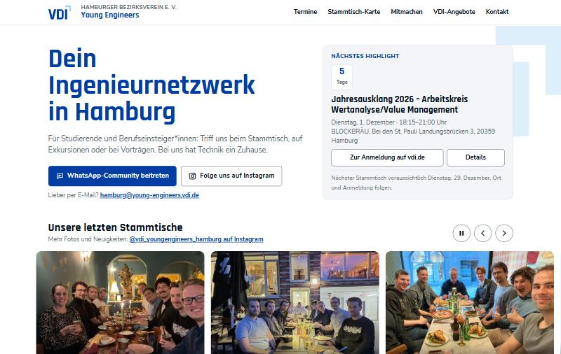

# VDI Hamburger Bezirksverein e. V. – Young Engineers

[](https://github.com/FeFoe/vdi-youngengineers/actions/workflows/pruefen.yml)
[](https://gohugo.io)
[](LICENSE)
[](content/barrierefreiheit.md)

Website der Young Engineers im VDI Hamburger Bezirksverein e. V. – das Netzwerk für Studierende und junge Berufstätige in Hamburg: Stammtische, Exkursionen und Vorträge.



## Was die Seite kann

- **Termine automatisch von vdi.de** – ein Scraper liest zweimal täglich die Veranstaltungen des Hamburger Bezirksvereins, der Nachbar-BVs, der Young Engineers bundesweit und der VDI-Webinare. Kinderangebote werden ausgefiltert.
- **Stammtisch-Prognose** – der Stammtisch am letzten Dienstag im Monat erscheint vorab als „geplant“ (außer an Hamburger Feiertagen) und wird ersetzt, sobald der echte Termin auf vdi.de steht. Im Kalender-Abo `/termine.ics` als Serientermin.
- **Termine entdecken** – Karten zum Wischen, Programm mit Filtern nach Veranstalter und Umkreis, Merkliste im Browser, Kalenderdatei je Termin.
- **Stammtisch-Karte** – alle bisherigen Orte auf einer eigenen Hamburg-Karte, verknüpft mit dem Fotostreifen.
- **Raus aus Hamburg** – Rückblick auf Kongress & DIT, EYE-Konferenzen, Regionalrunden und mehr.
- **Linkseite `/links/`** – Ersatz für Linktree in der Instagram-Bio: nächster Stammtisch und Termine in Hamburg aktualisieren sich automatisch, dazu WhatsApp, Instagram und feste Links.
- **WhatsApp ohne Spam** – Nummer und Community-Link stehen nie im Klartext im HTML oder im Repo. Erst nach einer kurzen Frage („Wofür steht das ‚V‘ in VDI?“) und einer unsichtbaren [ALTCHA](https://altcha.org)-Rechenaufgabe werden sie im Browser entschlüsselt.

## Grundsätze

| | |
|---|---|
| **Datensparsam** | Keine Cookies, kein Tracking, keine externen Ressourcen. Schriften und Skripte kommen vom eigenen Server, der Webserver schreibt kein Zugriffsprotokoll. |
| **Barrierearm** | WCAG 2.2 AA / EN 301 549 als Maßstab: Tastaturbedienung, Fokusführung in Dialogen, Kontraste ≥ 4,5 : 1, Terminliste auch ohne JavaScript. |
| **VDI-CI** | Rajdhani und Nunito Sans, VDI-Blau `#003DA4`, Hellblau `#9DD0F4`, Orange `#FE5A00` nur für Anmeldungen, Young-Engineers-Signet. |
| **Einfach zu pflegen** | Inhalte in YAML und Markdown – kein CMS, keine Datenbank, kein Build-Tooling außer Hugo. |

## Lokal starten

Voraussetzungen: [Hugo extended](https://gohugo.io/installation/) ab 0.160, Python ab 3.11.

```sh
cp data/kontakt_whatsapp.beispiel.yaml data/kontakt_whatsapp.yaml   # Werte eintragen (nicht im Git)
python3 tools/vdi_termine.py     # Termine von vdi.de holen  → data/vdi.json
python3 tools/wa_schutz.py       # WhatsApp-Ziele verschlüsseln → data/wa_schutz.json
hugo server                      # http://localhost:1313
```

Ohne die erzeugten Dateien baut die Seite trotzdem – dann ohne vdi.de-Termine und ohne WhatsApp-Ziele.

## Inhalte pflegen

| Was | Wo |
|---|---|
| Kontakt, Leitungsteam, Instagram | [`data/kontakt.yaml`](data/kontakt.yaml) |
| WhatsApp-Nummer, Community-Link | `data/kontakt_whatsapp.yaml` – nur lokal und auf dem Server, Vorlage: [`kontakt_whatsapp.beispiel.yaml`](data/kontakt_whatsapp.beispiel.yaml) |
| Vergangene Stammtische (Karte, Fotos) | [`data/stammtische.yaml`](data/stammtische.yaml) + Foto in `assets/fotos/` |
| Stammtisch-Regel, Feiertage, Ausfälle | [`data/stammtisch.yaml`](data/stammtisch.yaml) |
| Termine von vdi.de korrigieren oder ausblenden | [`data/termine_anpassungen.yaml`](data/termine_anpassungen.yaml) |
| Eigener Termin, der nicht auf vdi.de steht | neue Datei in `content/termine/` (Vorlage unten) |
| VDI-Angebote | [`data/angebote.yaml`](data/angebote.yaml) |
| Feste Links der Linkseite `/links/` (Instagram-Bio) | [`data/links.yaml`](data/links.yaml) – Termine dort kommen automatisch |
| Rückblick „Raus aus Hamburg“ | [`data/formate.yaml`](data/formate.yaml), [`data/ueberregional.yaml`](data/ueberregional.yaml), Fotos in `assets/rueckblick/` |
| Impressum-Angaben, Vorstand | [`data/verein.yaml`](data/verein.yaml) |
| Quellen des Termin-Scrapers | [`tools/vdi_termine.toml`](tools/vdi_termine.toml) |

<details>
<summary>Vorlage für einen eigenen Termin</summary>

```yaml
---
title: Young Engineers Stammtisch Dezember
start: 2026-12-29T18:30:00+01:00
end: 2026-12-29T21:30:00+01:00
place: Name der Location
address: Straße 1, 20095 Hamburg
geo: [53.55, 9.99]
icon: stammtisch          # Namen siehe ICONS in assets/js/app.js
group: ye                 # ye, yenet, hh, nord, vdi
tags: [Erster Drink frei]
# url: https://www.vdi.de/…   sobald es eine Anmeldeseite gibt
---
Erster Absatz der Beschreibung.
```
</details>

## Aufbau

```
assets/   CSS, JavaScript, Fotos (Hugo erzeugt verkleinerte WebP-Versionen)
content/  Startseite, Impressum, Datenschutz, Barrierefreiheit, eigene Termine
data/     gepflegte Daten (YAML); erzeugte Daten vdi.json und wa_schutz.json sind nicht im Git
deploy/   Einrichtung und Betrieb auf der VM: Skripte, systemd-Timer, Caddy
docs/     Bilder für diese README
layouts/  Hugo-Templates
static/   Schriften (WOFF2), ALTCHA, Favicon
tools/    vdi_termine.py (Scraper), wa_schutz.py (Verschlüsselung) – nur Python-Standardbibliothek
```

## Prüfen und Ausliefern

```
Pull Request / Push ──▶ GitHub Actions „Prüfen“ (unter 1 Minute)
main ──── VM holt alle 5 min ──▶ Hugo-Build ──▶ Caddy (HTTPS) ──▶ Website
                                   ▲
                 vdi.de ── Termine 05:30 und 17:30 Uhr
```

- **CI:** [`.github/workflows/pruefen.yml`](.github/workflows/pruefen.yml) baut die Seite, prüft die Skripte und stellt sicher, dass keine WhatsApp-Daten im Build landen. Läuft nur bei Änderungen an Code und Inhalten, nicht bei Doku. Pushes laufen auf einem eigenen Runner im Server-Container (keine Action-Minuten), Pull Requests aus Sicherheitsgründen auf GitHub-Runnern.
- **CD ohne Action-Minuten:** Die VM holt neue Commits selbst ab (systemd-Timer). GitHub braucht dafür weder SSH-Zugang noch Secrets.
- **Einrichtung:** einmalig `deploy/einrichten.sh --vorschau PASSWORT` (nicht indexiert, Passwortschutz) oder `--live` – siehe [`deploy/README.md`](deploy/README.md).

## Lizenz

- **Code** (Templates, CSS, JavaScript, Skripte): [MIT](LICENSE)
- **Inhalte** (Texte, Fotos, Porträts): alle Rechte vorbehalten
- **VDI-Logo und Young-Engineers-Signet**: Marken des VDI e. V.
- **Schriften** Rajdhani und Nunito Sans: [SIL OFL 1.1](static/fonts/OFL.txt) · **ALTCHA**: MIT · **Kartengeometrie**: © OpenStreetMap-Mitwirkende, ODbL
